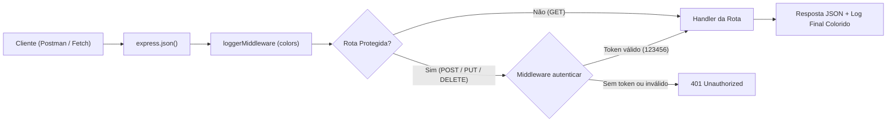

# 🚀 Atividade A1 (Nível Jedi) — API RESTful de Produtos

- **Aluno:** Bruno Freitas de Souza
- **Turno:** Vespertino
- **Nível escolhido:** Nível Jedi (Extra desafio — Completo)

---

## 📌 Sobre o Projeto

Esta é uma API RESTful para gerenciamento de **Produtos** em memória, desenvolvida com **Node.js** e **Express** como entrega da **Avaliação A1** (contemplando integralmente os requisitos dos níveis **Básico**, **Intermediário**, **Avançado** e **Jedi**):

1. **Modularização (CommonJS):** Separação das regras de negócio e dados em memória no módulo próprio [`src/modules/produtosService.js`](./src/modules/produtosService.js), além de middlewares independentes em `src/middlewares/`.
2. **Operações CRUD completas + Filtro por ID:**
   - `GET /produtos` — Lista todos os produtos (`200 OK`).
   - `GET /produtos/:id` — Filtra um produto por ID via parâmetro de rota (`req.params.id`), exibindo o valor recebido (`200 OK` ou `404 Not Found`).
   - `POST /produtos` — Cadastra um novo produto em memória (`201 Created`).
   - `PUT /produtos/:id` — Atualiza os dados de um produto existente (`200 OK`, `400 Bad Request` se `nome` vier vazio ou `preco` não for número maior que 0, ou `404 Not Found`).
   - `DELETE /produtos/:id` — Remove um produto da lista em memória (`200 OK` ou `404 Not Found`).
3. **Middleware de Logging Colorido (`colors`):** Registra no terminal a entrada da requisição e, ao finalizar a resposta, destaca os *Status Codes* por cores (`2xx` em verde, `3xx` em ciano, `4xx` em amarelo e `5xx` em vermelho).
4. **Middleware de Autenticação Básica:** Protege as rotas de escrita (`POST`, `PUT` e `DELETE`) exigindo o token fixo `123456` no cabeçalho (`x-token`), retornando `401 Unauthorized` quando ausente ou incorreto.

---

## 📂 Estrutura de Pastas

```text
Bruno Freitas de Souza/
├── src/
│   ├── middlewares/
│   │   ├── autenticar.js       # Middleware de autenticação por token fixo no header
│   │   └── logger.js           # Middleware de logging com destaque de status codes (colors)
│   ├── modules/
│   │   └── produtosService.js  # Módulo próprio com dados em memória e funções CRUD
│   ├── server.js               # Servidor Express e definição das rotas
│   └── testes.js               # Script automatizado para validar todos os cenários da API
├── package.json                # Manifesto do projeto, scripts e dependências
└── README.md                   # Documentação da API e evidências de testes
```

---

## 🔄 Fluxo de Execução e Middlewares

Toda requisição recebida pelo servidor percorre o seguinte fluxo no Express:



---

## 🛠️ Como Executar o Projeto

### 1. Instalar as dependências

Abra o terminal na pasta do projeto (`Atividades-A1/Vespertino/Bruno Freitas de Souza`) e execute:

```bash
npm install
# Caso o package.json tenha sido ignorado pelo .gitignore da raiz do repositório:
npm init -y && npm install express colors
```

### 2. Iniciar o servidor

Para rodar o servidor na porta `3000`:

```bash
npm start
```

Ou em modo de desenvolvimento com reinicialização automática (`--watch`):

```bash
npm run dev
```

O servidor ficará disponível em `http://localhost:3000`.

### 3. Executar a bateria de testes automatizados

Você também pode validar todas as rotas (sucesso e erro) com um único comando:

```bash
npm test
```

São 11 testes. Cada um compara o status recebido com o esperado e mostra ✅ (passou) ou ❌ (falhou). Se algum teste falhar, o comando termina com código de saída `1`.

---

## 📖 Documentação dos Endpoints

### Cabeçalhos (Headers) Necessários

- **Rotas com corpo JSON (`POST` e `PUT`):**
  - `Content-Type: application/json`
- **Rotas protegidas (`POST`, `PUT` e `DELETE`):**
  - `x-token: 123456` *(também aceita `x-access-token: 123456` ou `Authorization: Bearer 123456`)*

### Tabela de Rotas

| Método   | Rota             | Protegida? | Status de Sucesso | Status de Erro     | Descrição                                      |
| :------- | :--------------- | :--------: | :---------------: | :----------------: | :--------------------------------------------- |
| `GET`    | `/`              | ❌ Não     | `200 OK`          | —                  | Exibe informações gerais e rotas da API        |
| `GET`    | `/produtos`      | ❌ Não     | `200 OK`          | —                  | Lista todos os produtos cadastrados em memória |
| `GET`    | `/produtos/:id`  | ❌ Não     | `200 OK`          | `404 Not Found`    | Busca um produto pelo `id` e exibe o parâmetro |
| `POST`   | `/produtos`      | 🔒 Sim     | `201 Created`     | `400` / `401`      | Cria um novo produto em memória                |
| `PUT`    | `/produtos/:id`  | 🔒 Sim     | `200 OK`          | `400` / `401` / `404` | Atualiza os dados de um produto pelo `id`   |
| `DELETE` | `/produtos/:id`  | 🔒 Sim     | `200 OK`          | `401` / `404`      | Remove um produto da memória pelo `id`         |

---

## 🧪 Evidências de Testes (Sucesso e Erro)

Abaixo estão os testes realizados na API, cobrindo listagem, filtro por ID, criação, atualização, remoção, bloqueio por autenticação (`401`), recurso inexistente (`404`) e validação de dados no `PUT` (`400`).

### 1. Listar todos os produtos (`GET /produtos` — Sucesso `200`)

- **Requisição:** `GET http://localhost:3000/produtos`
- **Resposta (`200 OK`):**
```json
[
  {
    "id": 1,
    "nome": "Notebook Gamer",
    "preco": 5499.9,
    "categoria": "Informática",
    "emEstoque": true
  },
  {
    "id": 2,
    "nome": "Mouse Sem Fio",
    "preco": 149.9,
    "categoria": "Periféricos",
    "emEstoque": true
  },
  {
    "id": 3,
    "nome": "Teclado Mecânico RGB",
    "preco": 329.9,
    "categoria": "Periféricos",
    "emEstoque": true
  },
  {
    "id": 4,
    "nome": "Monitor 27 Polegadas 144Hz",
    "preco": 1399,
    "categoria": "Monitores",
    "emEstoque": false
  }
]
```

### 2. Filtrar produto por ID (`GET /produtos/2` — Sucesso `200`)

- **Requisição:** `GET http://localhost:3000/produtos/2`
- **Resposta (`200 OK`):**
```json
{
  "parametroRecebido": "2",
  "produto": {
    "id": 2,
    "nome": "Mouse Sem Fio",
    "preco": 149.9,
    "categoria": "Periféricos",
    "emEstoque": true
  }
}
```

### 3. Filtrar produto por ID inexistente (`GET /produtos/999` — Erro `404`)

- **Requisição:** `GET http://localhost:3000/produtos/999`
- **Resposta (`404 Not Found`):**
```json
{
  "erro": "Produto não encontrado.",
  "parametroRecebido": "999"
}
```

### 4. Tentar criar produto SEM token (`POST /produtos` — Erro `401`)

- **Requisição:** `POST http://localhost:3000/produtos` (sem header `x-token`)
- **Resposta (`401 Unauthorized`):**
```json
{
  "erro": "Token não fornecido. Envie o cabeçalho 'x-token: 123456' para acessar esta rota."
}
```

### 5. Tentar criar produto com token INVÁLIDO (`POST /produtos` — Erro `401`)

- **Requisição:** `POST http://localhost:3000/produtos`
- **Header:** `x-token: token-invalido`
- **Resposta (`401 Unauthorized`):**
```json
{
  "erro": "Token inválido. Acesso negado."
}
```

### 6. Criar produto com token VÁLIDO (`POST /produtos` — Sucesso `201`)

- **Requisição:** `POST http://localhost:3000/produtos`
- **Headers:**
  - `Content-Type: application/json`
  - `x-token: 123456`
- **Body (JSON):**
```json
{
  "nome": "Headset Gamer 7.1",
  "preco": 299.9,
  "categoria": "Áudio",
  "emEstoque": true
}
```
- **Resposta (`201 Created`):**
```json
{
  "id": 5,
  "nome": "Headset Gamer 7.1",
  "preco": 299.9,
  "categoria": "Áudio",
  "emEstoque": true
}
```

### 7. Atualizar produto com token VÁLIDO (`PUT /produtos/2` — Sucesso `200`)

- **Requisição:** `PUT http://localhost:3000/produtos/2`
- **Headers:**
  - `Content-Type: application/json`
  - `x-token: 123456`
- **Body (JSON):**
```json
{
  "preco": 129.9,
  "emEstoque": false
}
```
- **Resposta (`200 OK`):**
```json
{
  "id": 2,
  "nome": "Mouse Sem Fio",
  "preco": 129.9,
  "categoria": "Periféricos",
  "emEstoque": false
}
```

### 8. Remover produto com token VÁLIDO (`DELETE /produtos/1` — Sucesso `200`)

- **Requisição:** `DELETE http://localhost:3000/produtos/1`
- **Header:** `x-token: 123456`
- **Resposta (`200 OK`):**
```json
{
  "mensagem": "Produto removido com sucesso!",
  "produtoRemovido": {
    "id": 1,
    "nome": "Notebook Gamer",
    "preco": 5499.9,
    "categoria": "Informática",
    "emEstoque": true
  }
}
```

### 9. Atualizar produto com preço NEGATIVO (`PUT /produtos/3` — Erro `400`)

- **Requisição:** `PUT http://localhost:3000/produtos/3`
- **Headers:**
  - `Content-Type: application/json`
  - `x-token: 123456`
- **Body (JSON):**
```json
{
  "preco": -5
}
```
- **Resposta (`400 Bad Request`):**
```json
{
  "erro": "Os campos 'nome' e 'preco' (número maior que 0) são obrigatórios."
}
```

### 10. Atualizar produto com preço em TEXTO (`PUT /produtos/3` — Erro `400`)

- **Requisição:** `PUT http://localhost:3000/produtos/3`
- **Headers:**
  - `Content-Type: application/json`
  - `x-token: 123456`
- **Body (JSON):**
```json
{
  "preco": "abc"
}
```
- **Resposta (`400 Bad Request`):**
```json
{
  "erro": "Os campos 'nome' e 'preco' (número maior que 0) são obrigatórios."
}
```

### 11. Atualizar produto com nome VAZIO (`PUT /produtos/3` — Erro `400`)

- **Requisição:** `PUT http://localhost:3000/produtos/3`
- **Headers:**
  - `Content-Type: application/json`
  - `x-token: 123456`
- **Body (JSON):**
```json
{
  "nome": ""
}
```
- **Resposta (`400 Bad Request`):**
```json
{
  "erro": "Os campos 'nome' e 'preco' (número maior que 0) são obrigatórios."
}
```

---

### ✅ Resultado do `npm test`

```text
✅ [Teste 1] GET /produtos (Total de itens: 4) -> Esperado: 200 | Recebido: 200
✅ [Teste 2] GET /produtos/2 -> Esperado: 200 | Recebido: 200
✅ [Teste 3] GET /produtos/999 (ID inexistente) -> Esperado: 404 | Recebido: 404
✅ [Teste 4] POST /produtos (Sem Token) -> Esperado: 401 | Recebido: 401
✅ [Teste 5] POST /produtos (Token Inválido) -> Esperado: 401 | Recebido: 401
✅ [Teste 6] POST /produtos (Token Válido) -> Esperado: 201 | Recebido: 201
✅ [Teste 7] PUT /produtos/2 (Token Válido) -> Esperado: 200 | Recebido: 200
✅ [Teste 8] DELETE /produtos/1 (Token Válido) -> Esperado: 200 | Recebido: 200
✅ [Teste 9] PUT /produtos/3 (preco -5) -> Esperado: 400 | Recebido: 400
✅ [Teste 10] PUT /produtos/3 (preco "abc") -> Esperado: 400 | Recebido: 400
✅ [Teste 11] PUT /produtos/3 (nome vazio) -> Esperado: 400 | Recebido: 400
🎉 TODOS OS TESTES PASSARAM!
```

*(O terminal também mostra o corpo de cada resposta; foi omitido aqui para facilitar a leitura.)*

### 🖥️ Saída do Logger Colorido no Terminal (`npm test`)

```text
[2026-10-28T13:09:02.175Z] ➡️  Requisição recebida no middleware: GET /produtos
[2026-10-28T13:09:02.180Z] ⬅️  GET /produtos - Status: 200 (5ms)

[2026-10-28T13:09:02.194Z] ➡️  Requisição recebida no middleware: GET /produtos/2
🔎 Parâmetro de rota recebido em GET /produtos/:id -> id = 2
[2026-10-28T13:09:02.196Z] ⬅️  GET /produtos/2 - Status: 200 (2ms)

[2026-10-28T13:09:02.200Z] ➡️  Requisição recebida no middleware: GET /produtos/999
🔎 Parâmetro de rota recebido em GET /produtos/:id -> id = 999
[2026-10-28T13:09:02.201Z] ⬅️  GET /produtos/999 - Status: 404 (1ms)

[2026-10-28T13:09:02.525Z] ➡️  Requisição recebida no middleware: POST /produtos
[2026-10-28T13:09:02.527Z] ⬅️  POST /produtos - Status: 401 (2ms)

[2026-10-28T13:09:02.546Z] ➡️  Requisição recebida no middleware: POST /produtos
[2026-10-28T13:09:02.547Z] ⬅️  POST /produtos - Status: 401 (1ms)

[2026-10-28T13:09:02.562Z] ➡️  Requisição recebida no middleware: POST /produtos
[2026-10-28T13:09:02.562Z] ⬅️  POST /produtos - Status: 201 (0ms)

[2026-10-28T13:09:02.578Z] ➡️  Requisição recebida no middleware: PUT /produtos/2
✏️  Parâmetro de rota recebido em PUT /produtos/:id -> id = 2
[2026-10-28T13:09:02.580Z] ⬅️  PUT /produtos/2 - Status: 200 (2ms)

[2026-10-28T13:09:02.594Z] ➡️  Requisição recebida no middleware: DELETE /produtos/1
🗑️  Parâmetro de rota recebido em DELETE /produtos/:id -> id = 1
[2026-10-28T13:09:02.595Z] ⬅️  DELETE /produtos/1 - Status: 200 (1ms)

[2026-10-28T13:09:02.610Z] ➡️  Requisição recebida no middleware: PUT /produtos/3
✏️  Parâmetro de rota recebido em PUT /produtos/:id -> id = 3
[2026-10-28T13:09:02.611Z] ⬅️  PUT /produtos/3 - Status: 400 (1ms)

[2026-10-28T13:09:02.616Z] ➡️  Requisição recebida no middleware: PUT /produtos/3
✏️  Parâmetro de rota recebido em PUT /produtos/:id -> id = 3
[2026-10-28T13:09:02.617Z] ⬅️  PUT /produtos/3 - Status: 400 (1ms)

[2026-10-28T13:09:02.624Z] ➡️  Requisição recebida no middleware: PUT /produtos/3
✏️  Parâmetro de rota recebido em PUT /produtos/:id -> id = 3
[2026-10-28T13:09:02.625Z] ⬅️  PUT /produtos/3 - Status: 400 (1ms)
```
